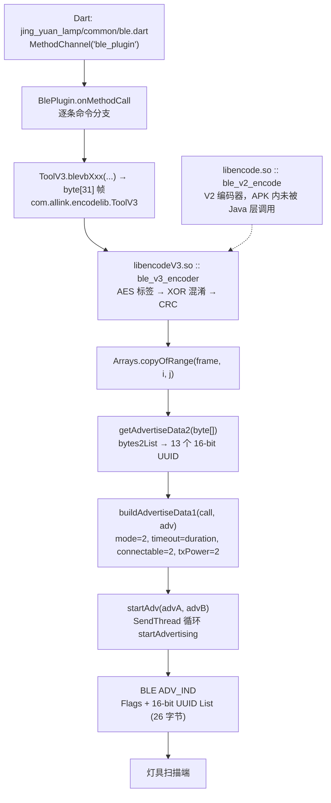

> **本仓库内的配套实现**
>
> - Dart 实现（本 App 实际使用）：`lib/protocol/`，由 `tools/gen_vectors.py` 生成的
>   `test/gold_vectors.dart` 用本文档 §6.1 的 32 条金向量逐字节对拍。
> - Python 参考实现（零依赖，夹具的唯一生成源）：`docs/reference-proto.py`。
>
> 两份实现都只覆盖 **V3**（线上 APK 只走 V3，§2），文档中的 V2 表格仅作对照。

# LampSmart Pro 蓝牙控制协议（逆向分析报告）

分析对象：`lampsmartpro.apk`（37.2 MB，包名 `com.jingyuan.lamp`）
配套参考实现：`docs/reference-proto.py`（零依赖，可直接生成控制帧）

置信度标记：

| 标记 | 含义 |
|---|---|
| **[已验证]** | 用 Unicorn 实际执行 APK 内原生库得到输出，或三方实现逐字节一致 |
| **[静态反汇编]** | 从 AArch64 反汇编 / DEX 字节码读出，未在真机上跑过 |
| **[推断]** | 由协议自洽性推出，未直接观测 |

---

## 0. 结论速览

这是一个**单向 BLE Legacy 广播**协议：手机把控制命令编码成 13 个 16-bit Service UUID，反复发 `ADV_IND`；灯具只监听，不建立连接。APK 里**完全没有 GATT 相关代码**（classes.dex / classes2.dex 的字符串池中 `Gatt` 出现 0 次，只用到 `Advertise*` 系列 API）**[已验证]**。

命令帧固定 **31 字节**：

| 字节 | 内容 |
|---|---|
| `b0..b4` | AD 结构模板：`02 01 02 1B 16`（Flags + Service Data 头），空中由系统协议栈重写 |
| `b5..b6` | 恒为 `F0 08`（16-bit UUID `0x08F0`，小端）——固件唯一校验的常量 |
| `b7` | 版本标志：V2 = `0x10`，V3 = `0x30` |
| `b8..b26` | 命令体（b9..b26 参与 XOR 混淆） |
| `b27..b28` | seed（决定 XOR 密钥与 CRC 初值） |
| `b29..b30` | CRC-16/CCITT，**对密文** `b7..b28` 计算，初值 `~seed` |

安全机制有三重，强度都很弱：

1. **XOR 混淆**：18 字节 `b9..b26` 与内置 128 字节表 `XBOXES` 按位置异或，再异或 `seed & 0xFF`（密钥完全由帧内 seed 决定）。
2. **CRC-16/CCITT**：`poly=0x1021`，MSB-first，不反射，无最终异或，初值 `~seed`，**在 XOR 之后对密文计算**。
3. **V3 AES 标签**：`b24..b25` = `AES-128-ECB(key = seed_lo, seed_hi, tx_count ‖ 13 字节常量, 明文 b8..b23)` 的密文前 2 字节（为 0 时改写 `0xFFFF`）。这是**对称且静态**的，密钥只差 seed 和 tx_count，等于无保护。

关键常量：

| 常量 | 值 |
|---|---|
| `XBOXES` | 见 [附录 A](#附录-axboxes-子密钥表)（128 字节，4 组 × 32 字节） |
| V3 AES 密钥尾 | `0d bf e6 42 68 41 99 2d 0f b0 54 bb 16`（13 字节） |
| UUID 前缀/后缀 | `0000` + `XXXX` + `-0000-1000-8000-00805f9b34fb` |
| `LIB_VERSION` | `1.0020200629`（两个 .so 相同）**[已验证]** |
| 帧长 | 31 (`0x1F`) |
| 版本字段 | `b7`：`0x10`=V2、`0x30`=V3 |

---

## 1. 分析方法与工具

APK 是 Flutter 应用（AOT 编译的 `libapp.so` 7.4 MB），协议逻辑因此分散在三层：

| 层 | 位置 | 方法 |
|---|---|---|
| Dart 业务层 | `libapp.so`（AOT） | 仅取字符串表确认 Dart 侧库路径 `package:jing_yuan_lamp/common/ble.dart`、`package:ble_plugin/ble_plugin.dart` **[静态反汇编]** |
| Java 插件层 | `classes.dex` 中 `com.allinktec.ble_plugin.BlePlugin` | 自写 DEX 解析器（class_data / method_id / 指令宽度表），解码字节码 **[静态反汇编]** |
| 原生协议层 | `lib/arm64-v8a/libencode.so`（V2）、`libencodeV3.so`（V3） | Capstone 反汇编 + pyelftools 解析符号/重定位 + **Unicorn 全函数仿真** **[已验证]** |


---

## 2. 架构与调用链



关键结论 **[静态反汇编]**：`BlePlugin.onMethodCall` 里每条 `blevbXxx` 分支的调用序列都是
`ToolV3.blevbXxx(...)` → `Arrays.copyOfRange` → `getAdvertiseData2` → `buildAdvertiseData1` → `startAdv`，
**全部指向 V3**（`ToolV3` 的 33 个 JNI 符号在 `libencodeV3.so` 中导出，`Tool` 的 25 个在 `libencode.so` 中）。V2 编码器也被打进 V3 库（`ble_v2_encode` 是 `libencodeV3.so` 的导出符号），但 Java 分发层没有走它——本 APK 线上只跑 V3。


---

### 2.1 验证链（三方一致才算通过）

```
参考实现 lampsmart_proto.py
        │  56 条指令帧逐字节比对
        ▼
独立的规范实现（按本报告规格重写）  ←── 168/168 与 Unicorn 仿真的原生输出逐字节一致
        │
        ▼
APK 自带的接收端代码 is_ble_v3_pdu + ble_v3_decoder（Unicorn 实跑）←── 32/32 接受并解出正确字段
```

---

## 3. 传输层：把命令塞进 Service UUID 列表

Android 的 `AdvertiseData` 不允许塞任意 AD 数据，但允许塞 16-bit Service UUID 列表。这个协议就把 31 字节帧的 **26 字节（`b5..b30`）拆成 13 个 16-bit UUID**，每个 UUID 值 = 对应的 2 字节（小端）。

### 3.1 装载算法 **[静态反汇编]**

`BlePlugin.bytes2List(byte[])`：

```java
String[26] nib = new String[26];        // 每个字节 -> 2 字符十六进制
for (i = 0; i < data.length; i++)
    nib[i] = to16String(data[i] / 16) + to16String(data[i] % 16);

String[13] out = new String[13];
for (i = 0; i < 13; i++)                // 索引步进 2
    out[i] = nib[2*i + 1] + nib[2*i];   // 高字节在前 -> UUID 字符串按大端书写
```

`BlePlugin.getAdvertiseData2(byte[])` / `getAdvertiseData(List)`：

```java
for (String s : list)
    builder.addServiceUuid(ParcelUuid.fromString("0000" + s + "-0000-1000-8000-00805f9b34fb"));
```

因为 UUID 在 BLE 空中是**小端**传输，而这里按**高字节在前**拼字符串，所以 13 个 UUID 回到空中时**逐字节还原**成帧的 `b5..b30`。这一点由固件侧常量校验反证：`is_ble_v3_pdu` 硬要求 `b5..b6 == F0 08`（`u16@5 == 0x08F0`），若字节被交换则所有命令都不可能被识别。

### 3.2 空中包结构 **[推断]**（与固件校验几何一致）

```
偏移  0    1    2    3    4    5    6   | 7 … 30
     02   01   xx   1B   02|03  F0   08   | 13 × 16-bit UUID 的小端字节 (= 帧 b5..b30)
      └─ Flags AD ─┘      └────── UUID 列表 AD (len=0x1B, type=0x02/0x03) ──────┘
```

`b0..b4` 是编码器写死的 AD 模板值，空中由系统协议栈按同样长度重写：`b0..b2` 是系统自动加的 Flags AD，`b3 = 0x1B`（1 字节类型 + 26 字节负载 = 27），`b4` 由系统填成 UUID 列表类型 `0x02`/`0x03`（模板里的 `0x16` 是 Service Data 类型）。固件**不校验 `b0..b4`**——`is_ble_v3_pdu` 只检查长度、`b5..b6` 和 CRC **[已验证]**（篡改 `b0..b4` 的负例仍返回"合法"）。

### 3.3 示例：一条 `LampOnOff(开)` 的完整空中包 **[已验证]**

帧（`var1=0x1234, var2=0x123456789ABCDEF0, var3=0x34, tx=0x42, seed=0x6BE9`）：

```
密文 0201021b16f0083080ca68c56d1cad52615d1b02ce5b9c5e1129cfe96b3ce6
明文 0201021b16f008308000423412f0debc9a34100000000000055300e96b3ce6
```

`b5..b30` 拆成 13 个 UUID 值：

```
000008f0 00008030 000068ca 00006dc5 0000ad1c 00006152 00001b5d
0000ce02 00009c5b 0000115e 0000cf29 00006be9 0000e63c
```

### 3.4 广播参数与重发 **[静态反汇编]**

`buildAdvertiseData1(MethodCall, AdvertiseData)` 从 `call.argument("duration").intValue()` 构造 `AdvertiseSettings`：

| Builder 调用 | 传入值 | Android 常量 |
|---|---|---|
| `setAdvertiseMode(2)` | 2 | `ADVERTISE_MODE_LOW_LATENCY` |
| `setTimeout(duration)` | Dart 传入的毫秒数 | — |
| `setConnectable(2)` | 2（`&1 == 0` → 实际不可连接） | `false` |
| `setTxPowerLevel(2)` | 2 | `ADVERTISE_TX_POWER_MEDIUM` |

`startAdv(AdvertiseData, AdvertiseData)` 接收两个广播包（一个来自 `getAdvertiseData2` 的帧 UUID 列表，一个来自 Dart 侧 `call.argument("data")` 的 UUID 字符串列表，见 `getAdvertiseData1`），通过 `SendThread` + `threadLock()` / `threadNotify()` 循环调用 `startAdvertising`，并注册 3 个 `AdvertiseCallback`。**每条命令实际发多少遍由 Dart 传入的参数控制，未能可靠解码**。

---

## 4. 控制帧格式（31 字节）

### 4.1 逐字节布局（V3，LampOnOff 开，seed=0x6BE9，tx=0x42）

| 偏移 | 明文值 | 含义 | 备注 |
|---|---|---|---|
| 0 | `02` | AD 长度 2 | 模板 |
| 1 | `01` | AD 类型 Flags | 模板 |
| 2 | `02` | Flags 值 | 模板，空中重写 |
| 3 | `1B` | 下一段 AD 长度 27 | 模板 = 1 + 26 |
| 4 | `16` | AD 类型 Service Data | 模板，空中重写为 UUID 列表类型 |
| 5–6 | `F0 08` | 16-bit UUID `0x08F0` | **固件硬校验** |
| 7 | `30` | 版本标志 | V2 = `0x10` |
| 8 | `80` | 固定 | V3 由 `struct[0]==0x10` 置 bit7 |
| 9 | `00` | 固定 | |
| 10 | `42` | `tx_count` | 发送计数 |
| 11–12 | `34 12` | `var1` (u16 LE) | |
| 13–16 | `F0 DE BC 9A` | `var2` (u32 LE) | 64 位入参截断到 32 位 |
| 17 | `34` | `var3` | |
| 18–19 | `10 00` | `cmd` (u16 LE) | 指令号 |
| 20–23 | `00 00 00 00` | 扩展参数 b20..b23 | 见指令表 |
| 24–25 | `55 30` | **V3 AES 标签** | V2 恒为 `0000` |
| 26 | `00` | 标志位 | 本 App 恒 0（`struct[0x16] & 0xF8`） |
| 27–28 | `E9 6B` | seed = `0x6BE9` | |
| 29–30 | `3C E6` | CRC-16 = `0xE63C` | 小端存放 |

### 4.2 V2 与 V3 的差异

| 项 | V2 (`libencode.so`) | V3 (`libencodeV3.so`) |
|---|---|---|
| `b7` 版本字节 | `0x10` | `0x30` |
| `b24..b25` | 恒 `0x0000`（结构体清零） | AES-128 标签 |
| `b26` | 恒 `0x00` | `struct[0x16] & 0xF8` |
| 指令数 | 24 条 + `GetLibVersion` | 32 条 + `GetLibVersion` |
| XOR 子表选择 | `k = struct[1] & 3` | `k = struct[2] & 3` |
| 其余布局 | 完全相同 | 完全相同 |

两版的 XBOXES 子表选择在本 App 中**恒为 0**（V2 结构体清零；V3 结构体固定为 `0x3010`，即 `struct[2] == 0`）。

### 4.3 `tx_count`

| 版本 | 位置 | 初值 | 行为 |
|---|---|---|---|
| V2 | `b10` | `.bss` 初值 0 | 每次发送先取值再自增（`out[10] = old; tx++`），8 位回绕 |
| V3 | `b10` | `.data` 初值 `0x10` | 同上（封装在 JNI wrapper 里，先自增再写结构体） |

`tx_count` 只作包计数，接收端不校验。**注意它参与 V3 AES 密钥**，所以复现时必须用同一个值算标签。

---

## 5. 算法细节

### 5.1 XOR 混淆 **[已验证]**

```python
for i in range(9, 27):                       # b9..b26，共 18 字节
    frame[i] ^= XBOXES[k * 32 + ((seed + i) & 0x1F)]
    frame[i] ^= (seed & 0xFF)
```

索引规则：`(seed + 绝对偏移) & 0x1F` 选 32 字节子表内的字节；`k` 由结构体字节决定（见 4.2）。因为 `seed` 就在同一帧的 `b27..b28`，接收端可以完全还原，属于**混淆而非加密**。

### 5.2 CRC-16/CCITT **[已验证]**

| 参数 | 值 |
|---|---|
| 多项式 | `0x1021` |
| 方向 | MSB-first（不反射） |
| 初值 | `init = ~seed & 0xFFFF`（随包变化） |
| 覆盖范围 | `b7..b28`（22 字节），**XOR 之后的密文** |
| 输出 | 小端存放在 `b29..b30` |
| 最终异或 | 无 |

标准校验值：`CRC16_CCITT("123456789", init=0xFFFF) = 0x29B1` ✔（参考实现与原生 `v2_crc16_ccitt` 一致）。

> 顺序很关键：原生代码先 XOR 混淆，再写 seed，最后对密文算 CRC。**先解密再算 CRC 会失败。**

### 5.3 V3 AES 标签 **[已验证]**

```python
key = bytes([seed & 0xFF, (seed >> 8) & 0xFF, tx_count]) + bytes.fromhex('0dbfe6426841992d0fb054bb16')
tag = AES_128_ECB(key, plaintext_b8_to_b23)[:2]      # 小端 u16
if tag == 0x0000:
    tag = 0xFFFF                                     # 原生规避零标签
```

- 密钥 = `seed_lo ‖ seed_hi ‖ tx_count ‖ 13 字节静态尾巴`（16 字节）
- 明文块 = **混淆前**的 `b8..b23`（16 字节），标签写入 `b24..b25` 后再参与 XOR
- 解码端（`ble_v3_decoder`）：先反 XOR，若 `b24..b25 != 0` 则用同样密钥重算并比对，不符即失败

---

## 6. 指令集

命名沿用 JNI 方法名（`blevbXxx`）。通用负载：`var1`（u16）、`var2`（u32，64 位入参截断）、`var3`（u8）；`b20..b23` 为各指令自有的扩展字节，`z` 表示 `on=true`。每条指令的**中文名称与用途见 [6.3](#63-中文名称与用途)**。

### 6.1 V3 指令表（32 条，App 实际使用）

金向量统一使用 `var1=0x1234, var2=0x123456789ABCDEF0, var3=0x34, tx_count=0x42, seed=0x6BE9` **[已验证]**

| # | JNI 方法 | 签名 | cmd 字节 | 扩展字段 b20..b23 | 明文帧 (31B, 解密后) | 线上帧 (31B, 加密后) |
|---|---|---|---|---|---|---|
| 1 | `Binding` | `(IJIZ)` | 0x45 - 0x1D*z  (z=1 -> 0x28 绑定 / z=0 -> 0x45 解绑) | — | `0201021b16f008308000423412f0debc9a34280000000000b32900e96b9072` | `0201021b16f0083080ca68c56d1cad52615d2302ce5b9c5ea753cfe96b9072` |
| 2 | `LampOnOff` | `(IJIZ)` | 0x11 - z  (z=1 -> 0x10 开 / z=0 -> 0x11 关) | — | `0201021b16f008308000423412f0debc9a34100000000000055300e96b3ce6` | `0201021b16f0083080ca68c56d1cad52615d1b02ce5b9c5e1129cfe96b3ce6` |
| 3 | `AidOnOff` | `(IJIZ)` | 0x13 - z  (z=1 -> 0x12 开 / z=0 -> 0x13 关) | — | `0201021b16f008308000423412f0debc9a341200000000008ae300e96b77f0` | `0201021b16f0083080ca68c56d1cad52615d1902ce5b9c5e9e99cfe96b77f0` |
| 4 | `Dimming` | `(IJIII)` | 0x21 固定 | b21 = 0, b22 = p4, b23 = p5 | `0201021b16f008308000423412f0debc9a34210000001234167300e96b4162` | `0201021b16f0083080ca68c56d1cad52615d2a02ce5b8e6a0209cfe96b4162` |
| 5 | `DimmingNight` | `(IJI)` | 0x23 固定 | — | `0201021b16f008308000423412f0debc9a342300000000003e9900e96b9f5a` | `0201021b16f0083080ca68c56d1cad52615d2802ce5b9c5e2ae3cfe96b9f5a` |
| 6 | `RgbAuto` | `(IJIZ)` | 0x1F - z  (z=1 -> 0x1E 开 / z=0 -> 0x1F 关) | — | `0201021b16f008308000423412f0debc9a341e0000000000133600e96b0e99` | `0201021b16f0083080ca68c56d1cad52615d1502ce5b9c5e074ccfe96b0e99` |
| 7 | `RgbOnOff` | `(IJII)` | 0x1C 固定 | b20 = 0, b21 = p4 | `0201021b16f008308000423412f0debc9a341c0000120000da6300e96b15d9` | `0201021b16f0083080ca68c56d1cad52615d1702ce499c5ece19cfe96b15d9` |
| 8 | `RgbSwitch` | `(IJIIII)` | 0x22 固定 | b21 = p4, b22 = p5, b23 = p6 | `0201021b16f008308000423412f0debc9a34220000123456643700e96b4a4e` | `0201021b16f0083080ca68c56d1cad52615d2902ce49a808704dcfe96b4a4e` |
| 9 | `FanMode` | `(IJIS)` | 0x33 固定 | b21 = p4(short) | `0201021b16f008308000423412f0debc9a34330000aa00001d4f00e96bcb71` | `0201021b16f0083080ca68c56d1cad52615d3802cef19c5e0935cfe96bcb71` |
| 10 | `FanSpeed` | `(IJISS)` | 0x31 固定 | b21 = p4(short), b22 = p5(short) | `0201021b16f008308000423412f0debc9a34310000aa01004a0700e96ba0f0` | `0201021b16f0083080ca68c56d1cad52615d3a02cef19d5e5e7dcfe96ba0f0` |
| 11 | `FanSwayOnOff` | `(IJII)` | 0x16 固定 | b20 = 0, b21 = p4 | `0201021b16f008308000423412f0debc9a3416000012000009c900e96bc580` | `0201021b16f0083080ca68c56d1cad52615d1d02ce499c5e1db3cfe96bc580` |
| 12 | `WindDircOnOff` | `(IJIZ)` | 0x15 固定 | b21 = z | `0201021b16f008308000423412f0debc9a34150000010000745500e96bafb8` | `0201021b16f0083080ca68c56d1cad52615d1e02ce5a9c5e602fcfe96bafb8` |
| 13 | `WarmOnOff` | `(IJIIZ)` | 0x66 固定 | b21 = p4, b22 = p5 | `0201021b16f008308000423412f0debc9a34660000123400970c00e96bdf45` | `0201021b16f0083080ca68c56d1cad52615d6d02ce49a85e8376cfe96bdf45` |
| 14 | `Ventilation` | `(IJIS)` | 0x67 固定 | b21 = p4(short) | `0201021b16f008308000423412f0debc9a34670000aa0000187500e96b7156` | `0201021b16f0083080ca68c56d1cad52615d6c02cef19c5e0c0fcfe96b7156` |
| 15 | `SwingOnOff` | `(IJIZ)` | 0xB0 固定 | b21 = z | `0201021b16f008308000423412f0debc9a34b00000010000eb9600e96b7a79` | `0201021b16f0083080ca68c56d1cad52615dbb02ce5a9c5effeccfe96b7a79` |
| 16 | `DryOnOff` | `(IJIZ)` | 0x69 固定 | b21 = z | `0201021b16f008308000423412f0debc9a34690000010000667500e96b6387` | `0201021b16f0083080ca68c56d1cad52615d6202ce5a9c5e720fcfe96b6387` |
| 17 | `BathOnOff` | `(IJIZ)` | 0x68 固定 | b21 = z | `0201021b16f008308000423412f0debc9a346800000100004ec700e96b0a49` | `0201021b16f0083080ca68c56d1cad52615d6302ce5a9c5e5abdcfe96b0a49` |
| 18 | `Temperature` | `(IJISS)` | 0x52 固定 | b21 = p4(short), b22 = p5(short) | `0201021b16f008308000423412f0debc9a34520000aa0100330900e96b5571` | `0201021b16f0083080ca68c56d1cad52615d5902cef19d5e2773cfe96b5571` |
| 19 | `TimingClose` | `(IJII)` | 0x41 固定 | b21 = p4 & 0xff, b22 = (p4 >> 8) & 0xff | `0201021b16f008308000423412f0debc9a3441000034120056e600e96bc087` | `0201021b16f0083080ca68c56d1cad52615d4a02ce6f8e5e429ccfe96bc087` |
| 20 | `GenericOnOff` | `(IJIZ)` | 0x6F 固定 | b21 = z | `0201021b16f008308000423412f0debc9a346f0000010000e60700e96b5afb` | `0201021b16f0083080ca68c56d1cad52615d6402ce5a9c5ef27dcfe96b5afb` |
| 21 | `SceneSet` | `(IJII)` | 0x46 固定 | b21 = p4 | `0201021b16f008308000423412f0debc9a34460000120000dceb00e96bbe5f` | `0201021b16f0083080ca68c56d1cad52615d4d02ce499c5ec891cfe96bbe5f` |
| 22 | `SceneSwitch` | `(IJII)` | 0x47 固定 | b21 = p4 | `0201021b16f008308000423412f0debc9a34470000120000e3cb00e96baed9` | `0201021b16f0083080ca68c56d1cad52615d4c02ce499c5ef7b1cfe96baed9` |
| 23 | `SceneReset` | `(IJII)` | 0x48 固定 | b21 = p4 | `0201021b16f008308000423412f0debc9a34480000120000531400e96b4e00` | `0201021b16f0083080ca68c56d1cad52615d4302ce499c5e476ecfe96b4e00` |
| 24 | `SceneOn` | `(IJI)` | 0x10 固定 | b21 = 1 | `0201021b16f008308000423412f0debc9a34100000010000790c00e96b9796` | `0201021b16f0083080ca68c56d1cad52615d1b02ce5a9c5e6d76cfe96b9796` |
| 25 | `AidBrigntness` | `(IJII)` | 0x2E 固定 | b21 = 3, b22 = p4 | `0201021b16f008308000423412f0debc9a342e0000031200c57500e96b83f6` | `0201021b16f0083080ca68c56d1cad52615d2502ce588e5ed10fcfe96b83f6` |
| 26 | `AidSpeed` | `(IJII)` | 0xE4 固定 | b22 = p4 | `0201021b16f008308000423412f0debc9a34e4000000120076bf00e96b57ea` | `0201021b16f0083080ca68c56d1cad52615def02ce5b8e5e62c5cfe96b57ea` |
| 27 | `AidPotUP` | `(IJI)` | 0x2F 固定 | b21 = 4 | `0201021b16f008308000423412f0debc9a342f0000040000cb8e00e96bb0f0` | `0201021b16f0083080ca68c56d1cad52615d2402ce5f9c5edff4cfe96bb0f0` |
| 28 | `AidPotDown` | `(IJI)` | 0x2F 固定 | b21 = 3 | `0201021b16f008308000423412f0debc9a342f00000300000f7c00e96b33ff` | `0201021b16f0083080ca68c56d1cad52615d2402ce589c5e1b06cfe96b33ff` |
| 29 | `AidPotAuto` | `(IJI)` | 0x2F 固定 | b21 = 1 | `0201021b16f008308000423412f0debc9a342f00000100009d8b00e96bfcdc` | `0201021b16f0083080ca68c56d1cad52615d2402ce5a9c5e89f1cfe96bfcdc` |
| 30 | `AidPotEdit` | `(IJII)` | 0x2F 固定 | b21 = 2, b22 = p4 & 0xff, b23 = (p4 >> 8) & 0xff | `0201021b16f008308000423412f0debc9a342f000002341279f300e96bba68` | `0201021b16f0083080ca68c56d1cad52615d2402ce59a84c6d89cfe96bba68` |
| 31 | `AidRgbModeUp` | `(IJI)` | 0x1B 固定 | b21 = 0 | `0201021b16f008308000423412f0debc9a341b0000000000917600e96bcf18` | `0201021b16f0083080ca68c56d1cad52615d1002ce5b9c5e850ccfe96bcf18` |
| 32 | `AidRgbModeDown` | `(IJI)` | 0x1B 固定 | b21 = 1 | `0201021b16f008308000423412f0debc9a341b00000100000fd000e96bd17b` | `0201021b16f0083080ca68c56d1cad52615d1002ce5a9c5e1baacfe96bd17b` |

签名含义（以 `Dimming(IJIII)` 为例）：`var1 = 0x1234`、`var2 = 0x123456789ABCDEF0`（截断为 `0x9ABCDEF0`）、`var3 = 0x34`、`b22 = 0x12`、`b23 = 0x34`。

**cmd 号冲突注意**：`LampOnOff(开)` 与 `SceneOn` 的 cmd 都是 `0x10`，靠 `b21` 区分（前者 0，后者 1）。同理 `AidOnOff(开)` = `0x12` 与 `AidPot*` 系列共用 `b21` 做子命令。

### 6.2 V2 指令表（24 条，App 打包但未走）

金向量使用 `var1=0x1234, var2=0x123456789ABCDEF0, var3=0x34, tx_count=0x42, seed=0x1A37` **[已验证]**

| # | JNI 方法 | 签名 | cmd 字节 | 扩展字段 b20..b23 | 明文帧 (31B, 解密后) | 线上帧 (31B, 加密后) |
|---|---|---|---|---|---|---|
| 1 | `Binding` | `(IJIZ)` | 0x45 - 0x1D*z  (z=1 -> 0x28 绑定 / z=0 -> 0x45 解绑) | — | `0201021b16f008108000423412f0debc9a34280000000000000000371a1f0c` | `0201021b16f008108080889003f1d67c6137bad2c646ef062233f0371a1f0c` |
| 2 | `LampOnOff` | `(IJIZ)` | 0x11 - z  (z=1 -> 0x10 开 / z=0 -> 0x11 关) | — | `0201021b16f008108000423412f0debc9a34100000000000000000371ad651` | `0201021b16f008108080889003f1d67c613782d2c646ef062233f0371ad651` |
| 3 | `AidOnOff` | `(IJIZ)` | 0x13 - z  (z=1 -> 0x12 开 / z=0 -> 0x13 关) | — | `0201021b16f008108000423412f0debc9a34120000000000000000371a65f1` | `0201021b16f008108080889003f1d67c613780d2c646ef062233f0371a65f1` |
| 4 | `Dimming` | `(IJIII)` | 0x21 固定 | b21 = 0, b22 = p4, b23 = p5 | `0201021b16f008108000423412f0debc9a34210000001234000000371a6d08` | `0201021b16f008108080889003f1d67c6137b3d2c646fd322233f0371a6d08` |
| 5 | `DimmingNight` | `(IJI)` | 0x23 固定 | — | `0201021b16f008108000423412f0debc9a34230000000000000000371a6bd6` | `0201021b16f008108080889003f1d67c6137b1d2c646ef062233f0371a6bd6` |
| 6 | `RgbAuto` | `(IJIZ)` | 0x1F - z  (z=1 -> 0x1E 开 / z=0 -> 0x1F 关) | — | `0201021b16f008108000423412f0debc9a341e00000000000000000371aac02` | `0201021b16f008108080889003f1d67c61378cd2c646ef062233f0371aac02` |
| 7 | `RgbOnOff` | `(IJII)` | 0x1C 固定 | b20 = 0, b21 = p4 | `0201021b16f008108000423412f0debc9a341c0000120000000000371a0d10` | `0201021b16f008108080889003f1d67c61378ed2c654ef062233f0371a0d10` |
| 8 | `RgbSwitch` | `(IJIIII)` | 0x22 固定 | b21 = p4, b22 = p5, b23 = p6 | `0201021b16f008108000423412f0debc9a34220000123456000000371a0ed9` | `0201021b16f008108080889003f1d67c6137b0d2c654db502233f0371a0ed9` |
| 9 | `FanMode` | `(IJIS)` | 0x33 固定 | b21 = p4(short) | `0201021b16f008108000423412f0debc9a34330000aa0000000000371ac394` | `0201021b16f008108080889003f1d67c6137a1d2c6ecef062233f0371ac394` |
| 10 | `FanSpeed` | `(IJISS)` | 0x31 固定 | b21 = p4(short), b22 = p5(short) | `0201021b16f008108000423412f0debc9a34310000aa0100000000371a118c` | `0201021b16f008108080889003f1d67c6137a3d2c6ecee062233f0371a118c` |
| 11 | `FanSwayOnOff` | `(IJII)` | 0x16 固定 | b20 = 0, b21 = p4 | `0201021b16f008108000423412f0debc9a34160000120000000000371a3012` | `0201021b16f008108080889003f1d67c613784d2c654ef062233f0371a3012` |
| 12 | `WindDircOnOff` | `(IJIZ)` | 0x15 固定 | b21 = z | `0201021b16f008108000423412f0debc9a34150000010000000000371a0b9f` | `0201021b16f008108080889003f1d67c613787d2c647ef062233f0371a0b9f` |
| 13 | `WarmOnOff` | `(IJIIZ)` | 0x66 固定 | b21 = p4, b22 = p5 | `0201021b16f008108000423412f0debc9a34660000123400000000371ae931` | `0201021b16f008108080889003f1d67c6137f4d2c654db062233f0371ae931` |
| 14 | `Ventilation` | `(IJIS)` | 0x67 固定 | b21 = p4(short) | `0201021b16f008108000423412f0debc9a34670000aa0000000000371a6cd4` | `0201021b16f008108080889003f1d67c6137f5d2c6ecef062233f0371a6cd4` |
| 15 | `SwingOnOff` | `(IJIZ)` | 0xB0 固定 | b21 = z | `0201021b16f008108000423412f0debc9a34b00000010000000000371ad535` | `0201021b16f008108080889003f1d67c613722d2c647ef062233f0371ad535` |
| 16 | `DryOnOff` | `(IJIZ)` | 0x69 固定 | b21 = z | `0201021b16f008108000423412f0debc9a34690000010000000000371a50d7` | `0201021b16f008108080889003f1d67c6137fbd2c647ef062233f0371a50d7` |
| 17 | `BathOnOff` | `(IJIZ)` | 0x68 固定 | b21 = z | `0201021b16f008108000423412f0debc9a34680000010000000000371a190f` | `0201021b16f008108080889003f1d67c6137fad2c647ef062233f0371a190f` |
| 18 | `Temperature` | `(IJISS)` | 0x52 固定 | b21 = p4(short), b22 = p5(short) | `0201021b16f008108000423412f0debc9a34520000aa0100000000371a441a` | `0201021b16f008108080889003f1d67c6137c0d2c6ecee062233f0371a441a` |
| 19 | `TimingClose` | `(IJII)` | 0x41 固定 | b21 = p4 & 0xff, b22 = (p4 >> 8) & 0xff | `0201021b16f008108000423412f0debc9a3441000034120000000000371a5e86` | `0201021b16f008108080889003f1d67c6137d3d2c672fd062233f0371a5e86` |
| 20 | `GenericOnOff` | `(IJIZ)` | 0x6F 固定 | b21 = z | `0201021b16f008108000423412f0debc9a346f0000010000000000371aa426` | `0201021b16f008108080889003f1d67c6137fdd2c647ef062233f0371aa426` |
| 21 | `SceneSet` | `(IJII)` | 0x46 固定 | b21 = p4 | `0201021b16f008108000423412f0debc9a34460000120000000000371ad803` | `0201021b16f008108080889003f1d67c6137d4d2c654ef062233f0371ad803` |
| 22 | `SceneSwitch` | `(IJII)` | 0x47 固定 | b21 = p4 | `0201021b16f008108000423412f0debc9a34470000120000000000371a91db` | `0201021b16f008108080889003f1d67c6137d5d2c654ef062233f0371a91db` |
| 23 | `SceneReset` | `(IJII)` | 0x48 固定 | b21 = p4 | `0201021b16f008108000423412f0debc9a34480000120000000000371aa250` | `0201021b16f008108080889003f1d67c6137dad2c654ef062233f0371aa250` |
| 24 | `SceneOn` | `(IJI)` | 0x10 固定 | b21 = 1 | `0201021b16f008108000423412f0debc9a34100000010000000000371a0516` | `0201021b16f008108080889003f1d67c613782d2c647ef062233f0371a0516` |

### 6.3 中文名称与用途

中文名称的证据分两档：

- **[UI]** —— APK 的 Dart 层字符串里能找到对应的中文文案（从 `libapp.so` 的 UTF-16 字符串表中提取），功能对应关系可靠。App 是多语言包（简中/繁中/英/日/法，无俄/韩），同一句文案常有多个写法，表里引的是能逐字确证的短串；
- **[推断]** —— APK 里没有对应文案，名称按 JNI 符号直译。

一个重要事实：`libencode*.so` 是厂商通用库（Java 包名 `com.allink.encodelib`），**指令集覆盖灯 + 风扇 + 浴霸/取暖器整个产品族**。而 LampSmart Pro 的界面文案里只出现灯与场景相关词汇（含"亮度"37 条、"彩灯"35 条、"辅助灯"6 条、"配对"9 条、"夜灯"3 条），**完全没有** `风扇`、`浴霸`、`干衣`、`暖风`、`摆风`、`导风`、`档位`、`风速`、`温度` 等字样。所以 6.3.3 里那 15 条属于"库里有、这个 App 没用"，照着发未必有设备响应。

#### 6.3.1 灯类指令（本 App 实际使用）

| # | JNI 方法 | cmd | 中文名称 | 用途 | 名称依据 |
|---|---|---|---|---|---|
| 1 | `Binding` | `0x28` / `0x45` | 配对 / 解除配对 | 让灯具开始接受这台手机的广播；解除后其他手机才能重新配对。App 文案："开始配对了""若设备闪烁或鸣叫则代表手机与设备成功配对""解除配对按钮" | [UI] |
| 2 | `LampOnOff` | `0x10` / `0x11` | 主灯开关 | 主照明（白光/暖光）的开与关。文案："开关灯" | [UI] |
| 3 | `AidOnOff` | `0x12` / `0x13` | 辅助灯开关 | 辅助照明（氛围灯/灯带）开关。文案："点击后可以打开辅助灯""开辅助灯""关闭辅助灯" | [UI] |
| 4 | `Dimming` | `0x21` | 色温调节（冷暖双色） | 一次设定两路光比：`b22` = 白光比例、`b23` = 黄光比例。App 有独立的色温控制页（i18n 串里有"色温"条目）。文案："白光比例""黄光比例" | [UI] |
| 5 | `DimmingNight` | `0x23` | 夜灯模式 | 切到夜灯（低亮度）照明模式，不带参数。文案："现在为夜灯模式了""都为夜灯模式了" | [UI] |
| 6 | `TimingClose` | `0x41` | 定时关闭 | 设定到点自动关灯的时长，`b21`/`b22` 是秒数的低/高字节（合计 u16 秒，最大 65535 秒）。文案："点击后可选择时间定时关闭设备" | [UI] |
| 7 | `RgbOnOff` | `0x1C` | 彩灯开关 | 单独开关彩色灯（与主灯分开），`b21` 为附加参数 | [UI] |
| 8 | `RgbAuto` | `0x1E` / `0x1F` | 彩灯循环开关 | 打开后彩灯颜色自动循环变化。文案："打开了彩灯循环""关闭彩灯循环""颜色会循环变化" | [UI] |
| 9 | `RgbSwitch` | `0x22` | 彩灯颜色设定 | 一次性设定三通道值（`b21`/`b22`/`b23`）。文案："将彩灯颜色调为红色/绿色/蓝色/黄色/紫色" | [UI] |
| 10 | `AidRgbModeUp` | `0x1B`（`b21=0`） | 彩灯模式 下一个 | 在预置色彩模式间向后切换。文案："模式切换""左右滑动可选择灯光颜色" | [UI] + [推断] |
| 11 | `AidRgbModeDown` | `0x1B`（`b21=1`） | 彩灯模式 上一个 | 同上，反方向切换 | [UI] + [推断] |
| 12 | `AidBrigntness` | `0x2E` | 辅助灯亮度设定 | 设定辅助灯亮度，`b21` 固定为 3（子命令号），`b22` 为亮度值 | [推断] |

#### 6.3.2 场景类指令（UI 有保存场景的文案，但未出现"场景"字样）

| # | JNI 方法 | cmd | 中文名称 | 用途 | 名称依据 |
|---|---|---|---|---|---|
| 13 | `SceneSet` | `0x46` | 场景保存 | 把当前房间所有灯的状态存成一组。App 文案："已将当前房间所有灯状态保存为" | [UI] |
| 14 | `SceneSwitch` | `0x47` | 场景切换 | 切到已保存的场景组，`b21` = 场景号。App 文案："逆序切换" | [UI] + [推断] |
| 15 | `SceneReset` | `0x48` | 场景复位 | 清除/重置某个已保存场景（App 无对应文案） | [推断] |
| 16 | `SceneOn` | `0x10`（`b21=1`） | 启用当前场景 | 启用场景组；与 `LampOnOff(开)` 共用 cmd `0x10`，靠 `b21=1` 区分 | [推断] |
| 17 | `GenericOnOff` | `0x6F` | 通用开关 | 厂商留给其他功能的通用开/关通道，`b21` = 开关值 | [推断] |

#### 6.3.3 风扇 / 浴霸 / 取暖类指令（库里有，本 App 未使用）

| # | JNI 方法 | cmd | 中文名称 | 用途 | 名称依据 |
|---|---|---|---|---|---|
| 18 | `FanMode` | `0x33` | 风扇模式 | 选择风类（常风/自然风等），`b21` = 模式值 | [推断] |
| 19 | `FanSpeed` | `0x31` | 风扇档位 / 风量 | 设定档位与风量：`b21` = 档位、`b22` = 风量 | [推断] |
| 20 | `FanSwayOnOff` | `0x16` | 风扇摆风开关 | 风扇叶片上下摆动开关，`b21` = 开关 | [推断] |
| 21 | `WindDircOnOff` | `0x15` | 导风板开关 | 固定导风方向（不吹头）开关 | [推断] |
| 22 | `SwingOnOff` | `0xB0` | 左右扫风开关 | 机身左右摇头扫风 | [推断] |
| 23 | `WarmOnOff` | `0x66` | 暖风 / 制热开关 | 取暖档加热，`b21`/`b22` 带附加设定 | [推断] |
| 24 | `Ventilation` | `0x67` | 通风换气 | 排气/换气档，`b21` = 档位 | [推断] |
| 25 | `DryOnOff` | `0x69` | 烘干 / 干衣 | 烘干衣物除湿排湿 | [推断] |
| 26 | `BathOnOff` | `0x68` | 浴霸开关 | 浴室取暖/照明一体机开关 | [推断] |
| 27 | `Temperature` | `0x52` | 温度设定 | 设定目标温度与相关风量，`b21`/`b22` 各一个 u16 参数 | [推断] |
| 28 | `AidSpeed` | `0xE4` | 辅助风速档位 | 辅助风路的档位设定，`b22` = 档位 | [推断] |
| 29 | `AidPotUP` | `0x2F`（`b21=4`） | 档位 +1 | 步进加一档 | [推断] |
| 30 | `AidPotDown` | `0x2F`（`b21=3`） | 档位 −1 | 步进减一档 | [推断] |
| 31 | `AidPotAuto` | `0x2F`（`b21=1`） | 档位自动 | 交由设备自动选择档位 | [推断] |
| 32 | `AidPotEdit` | `0x2F`（`b21=2`） | 档位直接设定 | 直接写入目标档位，`b22`/`b23` 为数值高/低字节 | [推断] |

#### 6.3.4 三组"同 cmd 不同参数"的判读要点

| 容易混淆的指令 | 区分方式 |
|---|---|
| `LampOnOff(开)` vs `SceneOn` | cmd 都是 `0x10`；`b21 = 0` 是主灯开，`b21 = 1` 是启用场景 |
| `AidOnOff` vs `AidPot*` | `AidOnOff` 是 `cmd 0x12/0x13`；`AidPot*` 共用 `cmd 0x2F`，靠 `b21` 取 1/2/3/4 区分自动/设定/减/加 |
| `AidRgbModeUp` vs `AidRgbModeDown` | 共用 `cmd 0x1B`；`b21 = 0` 向后、`b21 = 1` 向前 |
| `RgbAuto` vs `RgbSwitch` | 前者是循环开关（`0x1E/0x1F`），后者是直接设定颜色（`0x22` + 三通道值） |

---

## 7. 灯侧校验与解码（逆向得到的接收端逻辑）

`libencodeV3.so` 还导出两个接收端函数（手机端不用，但它们定义了协议的对端语义）**[已验证]**：

### `is_ble_v3_pdu(const uint8_t *buf, size_t len)`

| 返回值 | 条件 |
|---|---|
| `0x1F` (31) | `len & 0xFF != 0x1F`（长度不是 31） |
| `0x1F` (31) | `u16le(buf + 5) != 0x08F0`（UUID 不对） |
| `0x13` (19) | CRC 不匹配 |
| `0x11` (17) | **合法** |

CRC 覆盖 `buf[7 .. 0x1C]`（22 字节），初值 `~u16le(buf + 0x1B)`，与帧内定义一致。注意它**不检查 `b7` 版本字节，也不检查 AES 标签**——V2/V3 的区分由固件上层用 `b7` 与标签自行处理。

### `ble_v3_decoder(const uint8_t *frame, size_t len, uint8_t *out24)`

1. 反 XOR（`b9..b26`，密钥同上）；
2. 若 `b24..b25 != 0`，用 `seed_lo ‖ seed_hi ‖ b10 ‖ 静态尾` 重算 AES 标签并比对，不符则失败；
3. 校验 CRC；
4. 反填 24 字节结构体：`out[1]=b7`、`out[2]=b8&0x7F`、`out[3]=b9`、`out[4]=b10`、`out[6..7]=b11..b12`、`out[8..11]=b13..b16`、`out[0xC]=b17`、`out[0xE..0xF]=b18..b19`、`out[0x10]=b20`；
5. 返回 0 表示成功。

> 换言之：只要 seed 在帧内，XOR 与 AES 标签都可由公开常量还原——这三条"安全"机制对协议复现者不构成任何障碍。

---

## 8. 参考实现与验证

### 8.1 用法

```python
import lampsmart_proto as lp

# 生成一条 V3 开灯命令（seed 可任意取，会原样写进帧里）
frame = lp.encode_v3('LampOnOff', seed=0x6BE9, tx_count=0x42,
                     var1=0x1234, var2=0x123456789ABCDEF0, var3=0x34, on=True)
print(frame.hex())
# 0201021b16f0083080ca68c56d1cad52615d1b02ce5b9c5e1129cfe96b3ce6

# 校验并解帧
info = lp.parse_frame(frame)
# {'version': 'V3', 'tx_count': 0x42, 'var1': 0x1234, 'var2': 0x9ABCDEF0, 'var3': 0x34,
#  'cmd': 0x10, 'extra': b'\x00\x00\x00\x00', 'tag': 0x5305, 'seed': 0x6BE9, 'crc': 0xE63C, ...}

# 拆成 13 个 16-bit UUID（= Android 塞进广播包的东西）
lp.as_uuids(frame)
# ['000008f0-0000-1000-8000-00805f9b34fb', '00008030-0000-1000-8000-00805f9b34fb', ...]

# V2 同理（载荷参数一致，便于与 6.2 表对照）
lp.encode_v2('Dimming', seed=0x1A37, tx_count=0x42, var1=0x1234,
             var2=0x123456789ABCDEF0, var3=0x34, p4=0x12, p5=0x34).hex()
# 0201021b16f008108080889003f1d67c6137b3d2c646fd322233f0371a6d08
```

`lampsmart_proto.py` 内置 CRC-16 与 AES-128（现场计算 S 盒），无第三方依赖。

### 8.2 验证结果（全部实际执行）

| 检查 | 范围 | 结果 |
|---|---|---|
| CRC-16/CCITT 标准校验值 | `"123456789"`, init `0xFFFF` | `0x29B1` ✔ |
| AES-128 对拍 pycryptodome + FIPS-197 KAT | 4 组 key/block | 全部一致 ✔ |
| 规范实现 vs 原生仿真（Unicorn） | 2 库 × 指令 × 3 组入参 × 3 个 tx | **168/168 逐字节一致** ✔ |
| 编码→解码往返（原生 `ble_v3_decoder`） | 6 指令 × 3 组 | **18/18** ✔ |
| 参考实现 vs 规范实现 vs 本文档表格 | 24(V2) + 32(V3) | **56/56 帧一致** ✔ |
| 原生 `is_ble_v3_pdu` 接受 + `ble_v3_decoder` 解码 | 全部 32 条 V3 金向量 | **32/32**，解出的版本/tx/var1/var2/var3/cmd 全部吻合 ✔ |
| 负例（改 CRC / 改长度 / 改 UUID / 改版本字节） | 4 例 | 原生分别返回 19/31/31/19，`verify_frame()` 全部判否 ✔ |

未覆盖的部分：**V2 没有原生解码器可对拍**（`libencode.so` 只导出编码器），V2 的正确性依据是 168 向量仿真的逐字节一致。

---

## 附录 A：XBOXES 子密钥表

128 字节 = 4 组 × 32 字节，来自两个 .so 的 `.rodata`（两库内容相同）**[已验证]**。本 App 恒用第 0 组。

```
组 0: b7fd9326 363ff7cc 34a5e5f1 71d83115 04c723c3 1896059a 071280e2 eb27b275
组 1: d0efaafb 434d3385 45f9027f 503c9fa8 51a3408f 929d38f5 bcb6da21 10fff3d2
组 2: e0323a0a 4906245c c2d3ac62 9195e479 e7c8376d 8dd54ea9 6c56f4ea 657aae08
组 3: e1f89811 69d98e94 9b1e87e9 ce5528df 8ca1890d bfe64268 41992d0f b054bb16
```

> V3 的 AES 密钥尾 13 字节恰好就是 `XBOXES` 第 4 组的最后 13 字节（`XBOXES[96+19 : 96+32]` = `0d bf e6 42 68 41 99 2d 0f b0 54 bb 16`）——同一段常量在库里被复用了两处 **[已验证]**。

## 附录 B：编码顺序（复现时必须一致）

```
1. 填 24 字节结构体：版本/负载/cmd/扩展字节
2. V3：对 b8..b23 做 AES-128-ECB，取前 2 字节 → 写入 b24..b25（0 则改 0xFFFF）
3. 对 b9..b26 做 XOR 混淆（XBOXES + seed 低字节）
4. 写入 b27..b28 = seed
5. 对**密文** b7..b28 计算 CRC-16/CCITT，初值 ~seed → 写入 b29..b30（小端）
```

## 附录 C：已确认与未确认

已确认（[已验证]）：帧格式、三重算法、56 条指令的 cmd 与参数映射、V3 帧能被 APK 自带的接收端代码接受并解出、Dart/Java 调用链。

未确认：

- 每条命令的实际重发次数与两个广播包的轮换策略（`SendThread`/`sendCount` 字段未能可靠解码）；
- Dart 侧传给 `copyOfRange` 的确切起止下标（几何上只能是 `(5, 31)`，即 26 字节 = 13 个 UUID）；
- 灯具固件收到合法帧后的行为（本报告只还原到"校验 + 解码"这一层）；
- 绑定流程 `Binding` 之后是否有额外握手（APK 内无对应逻辑）。
